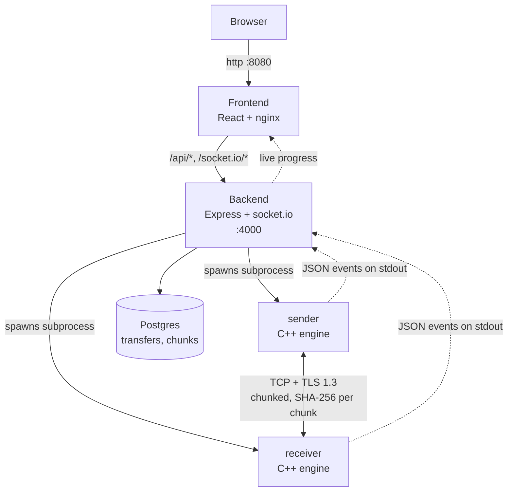

# data-transfer-sys

A file transfer engine written in C++ (TLS-encrypted, resumable, pipelined
for throughput) wrapped in a full-stack dashboard: a Node/Express API with
Postgres persistence, and a React frontend with live progress over
WebSocket.

The engine works standalone as two CLI binaries (`sender`, `receiver`). The
rest of the stack turns it into something you drive from a browser instead
of a terminal.

## Architecture



Every layer only talks to the one next to it:

- **Frontend** never calls the engine or the database directly — everything
  goes through the backend's REST API and one WebSocket connection.
- **Backend** never links against the engine or speaks its wire protocol.
  It spawns `sender`/`receiver` as subprocesses and reads **one
  newline-delimited JSON object per event** off their stdout — that's the
  entire bridge. No socket, no shared memory, no IPC beyond a pipe.
- **Engine** (`sender`/`receiver`) has no idea a backend exists. It's a
  standalone CLI tool with its own resumable, TLS-encrypted, pipelined
  chunk-transfer protocol; the JSON event stream is just how it reports
  progress to whatever spawned it.

### Why JSON-over-stdout instead of a socket/HTTP endpoint in the engine

The alternative would be giving the C++ binaries their own HTTP or RPC
server so the backend could poll or subscribe to them directly. That adds
a second protocol, a second port to manage, and couples the engine's
lifecycle to always running as a server. Reading structured lines off
stdout of a process you already spawned and already have a handle to is
simpler in every direction: no extra listening port, no discovery problem,
and the engine stays a plain CLI tool that works identically whether a
backend is driving it or a person is running it by hand in a terminal.

## Running it

Requires Docker and Docker Compose.

```sh
docker compose up -d --build
```

Then open **http://localhost:8080**.

Files you want to transfer need to be visible inside the containers.
`docker-compose.yml` bind-mounts `./data` (next to this file) into the
backend at `/data` — drop files there and reference them as `/data/...`
in the "new transfer" form (e.g. source `/data/myfile.bin`, destination
`/data/out`).

First startup runs pending Prisma migrations automatically
(`backend/docker-entrypoint.sh`) — no manual database setup needed.

### Running the engine standalone (no Docker, no backend)

```sh
# terminal 1
receiver -p 8080 -o ./received

# terminal 2
sender -p 8080 ./some-file-or-directory
```

Both take `--help` for the full flag list. The ones worth knowing:

| Flag | Applies to | What it does |
|---|---|---|
| `--chunk-size <bytes>` | sender | Bytes per chunk (default 64 KiB, range 4 KiB–8 MiB). Bigger chunks mean fewer round trips — see the performance section. |
| `--window <n>` | sender | Chunks allowed in flight at once before waiting for an ack (default 16). |
| `--bench <path>` | sender | Writes per-chunk stage timings (disk read / hash / send / ack) to a CSV. |
| `--no-tls` | both | Skips the TLS handshake. Debug/benchmark only — both sides must set it, or the connection fails. |
| `--transfer-id <id>` | both | Tags every emitted JSON event; the backend uses this to correlate a sender/receiver pair to one database row. |

## How the engine works

- **Resumable.** Interrupt a transfer (kill the process, lose the network)
  and re-run the same sender command — it picks up from the last
  chunk the receiver durably wrote, verified against both file size and
  chunk size so a changed source file or a different `--chunk-size`
  correctly restarts from scratch instead of producing a corrupted splice.
- **Verified.** Every chunk is SHA-256 hashed by the sender and checked by
  the receiver before being written and acknowledged.
- **Pipelined.** A sliding window of chunks can be in flight at once,
  handled by four cooperating threads (disk reader → hasher → network
  sender, with a separate thread reading acks) instead of the naive
  send-one-wait-for-its-ack-send-next approach. See
  [Performance](#performance) for what this actually bought.
- **Encrypted.** TLS 1.3 by default. The receiver generates a fresh
  self-signed certificate on every start — this protects the transfer
  against passive eavesdropping on the wire, but **not** against an active
  machine-in-the-middle on the very first connection to a given receiver,
  since there's no trust anchor to check the certificate against. There's
  no certificate pinning across runs.
- **Cross-platform.** The same source builds and runs natively on Windows
  and Linux; sender and receiver interoperate in either direction
  regardless of which platform each side is running on.
- **A hash mismatch aborts the session** rather than retrying the bad
  chunk in place. Once chunks are pipelined, chunks after a bad one may
  already be in flight or received by the time its failure is known, so a
  clean single-chunk retry isn't possible without the receiver buffering
  out-of-order chunks. Disconnecting and relying on resume is far less
  code, and a real mismatch should be rare — TCP already checksums the
  byte stream, so this mostly catches logic bugs, not routine transit
  noise.

## Performance

Replacing stop-and-wait chunk transfer with the sliding-window pipeline
described above gave a **13–16× throughput improvement** at realistic
network latency (20–50 ms round trip) — stop-and-wait is bound by
`chunk_size / RTT`, a cost that's invisible on localhost and dominates
completely over any real link, independent of file size.

Chunk size turned out to matter even more: per-stage timing isolation
(reading `--bench` output) found that neither disk (~500–650 MB/s) nor
SHA-256 (~600–700 MB/s) were ever the bottleneck — it was the ack-listener
thread's `recv()` calls, at roughly 2.9 ms each, which dominates total time
once there are thousands of small chunks. Fewer, bigger chunks means
proportionally fewer acks: pushing chunk size to the protocol maximum
(8 MiB) reached **~200–290 MB/s**, roughly 10× the default 64 KiB result.

TLS costs nothing measurable at the sizes tested, consistent with
hardware-accelerated AES-GCM on modern CPUs.

Full methodology, all charts, the complete before/after data, and the
known limitations of this benchmark (single machine, one pass per
condition, no `iperf3`/`fio` baseline for a true I/O ceiling) are in the
published report:
**[Pipelining rework: throughput benchmark](https://claude.ai/code/artifact/c4dc1658-917e-4461-81ef-c57067192527)**

Reproduce it with `tools/benchmark.ps1` — see the script's own header
comment for why latency is simulated with a small TCP proxy
(`tools/latency-proxy.js`) rather than a `Sleep()` inside the receiver.

## Known limitations / out of scope

These are deliberate, not oversights:

- **No authentication.** Neither the dashboard nor the API has a login —
  anyone who can reach the backend can start, view, or cancel transfers.
  Fine for local/demo use; would need real auth before exposing this
  anywhere untrusted.
- **TLS is confidentiality, not identity.** See the self-signed
  certificate note above — no MITM protection on first connection.
- **No secrets management.** The Postgres password in `docker-compose.yml`
  is a hardcoded dev default. Fine for local use; would need real secret
  injection for actual production deployment.
- **One process per transfer, not one process handling many.** The
  backend spawns a fresh `sender`/`receiver` pair per transfer rather than
  one long-running engine process multiplexing several sessions. This
  already gives real OS-level concurrency (multiple transfers just run as
  multiple process pairs) without needing an async I/O rewrite — revisit
  only if process-spawn overhead is ever actually measured as a problem.
- **No `htonl`/`ntohl` byte-order handling on the wire protocol.** Every
  platform this currently runs on (Windows and Linux, both x86-64) is
  little-endian, so this is a real gap only for a future big-endian
  target, not for anything deployed today.
- **No zero-copy send.** Benchmark data showed disk read and hashing
  aren't the bottleneck (see [Performance](#performance)), so the
  optimization `TransmitFile`/`sendfile` would provide isn't where the
  time actually goes.
- **No CI.** Nothing builds or tests these images automatically on push.

## Project layout

```
sender/, receiver/   the two CLI binaries (C++)
shared/               protocol, TLS, hashing, and pipeline code shared by both
backend/              Express API + Prisma/Postgres + socket.io
frontend/             React dashboard (Vite + Tailwind)
tools/                benchmark harness, latency proxy, bench-log analysis
docker-compose.yml    the whole stack
```
