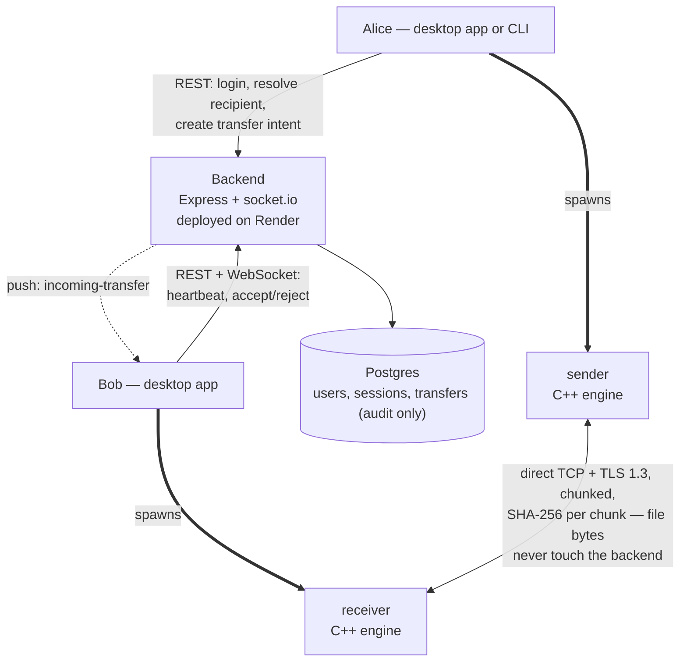

# PeerPayload

Send a file directly to a colleague's machine. Log in, pick their name from
a list of who's online, and the transfer runs straight between the two of
you — the file's bytes never pass through a server. A small backend only
handles accounts, presence ("who's online right now"), and an audit trail
of what was sent, to whom, and whether it finished.

Two ways to use it, sharing one implementation underneath:

- **Desktop app** (Electron + React) — install it, sign in, pick a
  colleague, send. Runs in the system tray so it can receive files in the
  background.
- **CLI** (`peerpayload`) — `login`, `send`, `status`, `history`. Send-only:
  receiving still needs someone's desktop app running on the other end.

The C++ transfer engine underneath (`sender`/`receiver`) also works as a
fully standalone pair of CLI binaries with no account system at all — see
[How the engine works](#how-the-engine-works).

## Architecture



This is a **control plane / data plane split**:

- **Control plane** (through the backend): who you are, who's online, and
  "does Bob want this file" — a REST API for everything except the live
  push notification, which goes over an authenticated per-user socket.io
  channel (`user:<id>` room).
- **Data plane** (direct, client-to-client): once Bob accepts, his client
  spawns `receiver`, Alice's client spawns `sender`, and the two connect
  to each other directly over TLS. The backend is never in this path and
  never sees file contents — only a final self-reported "it worked" or
  "it failed" for the audit log.

### Components

| Path | What it is |
|---|---|
| `sender/`, `receiver/`, `shared/` | The C++ engine — TLS, resumable, pipelined chunk transfer. No knowledge of accounts, backend, or either client. |
| `backend/` | Express + Prisma/Postgres + socket.io. Auth (bearer tokens, DB-backed sessions so admin revocation is immediate), presence (heartbeat + TTL), directory lookup, and transfer audit records. Deployed on Render. |
| `client-core/` | The one client-side implementation of "talk to the backend" and "spawn the engine and read its JSON event stream" — shared by both `desktop/` and `cli/` so there's exactly one copy of that logic. |
| `desktop/` | Electron + React. `electron-builder` produces a Windows installer (NSIS) and a Linux AppImage. |
| `cli/` | `peerpayload` — commander-based, `login`/`send`/`status`/`history`. |
| `packages/ui/` | Presentational React components (`Meter`, `StatTile`, `StatusBadge`, `ThemeToggle`) shared between `desktop/` and (originally) `frontend/`. |
| `frontend/` | **Legacy.** A React dashboard from before the accounts/presence rework — still assumes the old no-auth, manual host/port/token model and does not speak the current backend's API. Not part of the working system; kept in the repo but not wired up. |
| `render.yaml` | Render Blueprint — deploys `backend/` and its Postgres together from one file. |

## Using it

The backend is already deployed; the client apps have its URL baked in at
build time, so there's no server address to configure.

**Desktop app:** install the built package for your platform, sign in with
an account an admin created for you, and send. Receiving requires the app
to be running (it can be minimized to the tray — closing the window
doesn't quit it).

**CLI:**

```sh
peerpayload login
peerpayload send "C:\path\to\file-or-folder" --to someusername
peerpayload status    # active transfers
peerpayload history   # everything
```

Add `--json` to any command for machine-readable output.

### Accounts

There's no self-registration. The first admin account is created directly
against the database:

```sh
cd backend
node src/scripts/createAdmin.js <username> <password>
```

From there, an admin creates everyone else's accounts through the `users`
API.

### Running the backend locally

```sh
cd backend
cp .env.example .env   # point DATABASE_URL at a local Postgres
npm install
npx prisma migrate dev
npm run dev
```

Point a client at it instead of the deployed backend with
`PEERPAYLOAD_SERVER=http://localhost:4000` (both the desktop app's dev
build and the CLI read this env var; the desktop app's `electron-builder`
config bakes in the production URL for a packaged install instead).

## How the engine works

- **Resumable.** Interrupt a transfer (kill the process, lose the network)
  and re-run the same sender command — it picks up from the last
  chunk the receiver durably wrote, verified against both file size and
  chunk size so a changed source file or a different `--chunk-size`
  correctly restarts from scratch instead of producing a corrupted splice.
- **Verified.** Every chunk is SHA-256 hashed by the sender and checked by
  the receiver before being written and acknowledged.
- **Pipelined.** A sliding window of chunks can be in flight at once,
  handled by four cooperating threads (disk reader → hasher → network
  sender, with a separate thread reading acks) instead of the naive
  send-one-wait-for-its-ack-send-next approach. See
  [Performance](#performance) for what this actually bought.
- **Encrypted.** TLS 1.3 by default. The receiver generates a fresh
  self-signed certificate on every start — this protects the transfer
  against passive eavesdropping on the wire, but **not** against an active
  machine-in-the-middle on the very first connection to a given receiver,
  since there's no trust anchor to check the certificate against. There's
  no certificate pinning across runs.
- **Cross-platform.** The same source builds and runs natively on Windows
  and Linux; sender and receiver interoperate in either direction
  regardless of which platform each side is running on.
- **A hash mismatch aborts the session** rather than retrying the bad
  chunk in place. Once chunks are pipelined, chunks after a bad one may
  already be in flight or received by the time its failure is known, so a
  clean single-chunk retry isn't possible without the receiver buffering
  out-of-order chunks. Disconnecting and relying on resume is far less
  code, and a real mismatch should be rare — TCP already checksums the
  byte stream, so this mostly catches logic bugs, not routine transit
  noise.

### Running the engine standalone (no accounts, no backend)

```sh
# terminal 1
receiver -p 8080 -o ./received

# terminal 2
sender -p 8080 ./some-file-or-directory
```

Both take `--help` for the full flag list. The ones worth knowing:

| Flag | Applies to | What it does |
|---|---|---|
| `--chunk-size <bytes>` | sender | Bytes per chunk (default 64 KiB, range 4 KiB–8 MiB). Bigger chunks mean fewer round trips — see the performance section. |
| `--window <n>` | sender | Chunks allowed in flight at once before waiting for an ack (default 16). |
| `--bench <path>` | sender | Writes per-chunk stage timings (disk read / hash / send / ack) to a CSV. |
| `--no-tls` | both | Skips the TLS handshake. Debug/benchmark only — both sides must set it, or the connection fails. |
| `--token <token>` | both | Shared-secret handshake auth. This is what a transfer intent's `engineToken` fills in automatically when the engine is spawned by the desktop app or CLI. |
| `--transfer-id <id>` | both | Tags every emitted JSON event; callers use this to correlate a sender/receiver pair to one transfer record. |

## Performance

Replacing stop-and-wait chunk transfer with the sliding-window pipeline
described above gave a **13–16× throughput improvement** at realistic
network latency (20–50 ms round trip) — stop-and-wait is bound by
`chunk_size / RTT`, a cost that's invisible on localhost and dominates
completely over any real link, independent of file size.

Chunk size turned out to matter even more: per-stage timing isolation
(reading `--bench` output) found that neither disk (~500–650 MB/s) nor
SHA-256 (~600–700 MB/s) were ever the bottleneck — it was the ack-listener
thread's `recv()` calls, at roughly 2.9 ms each, which dominates total time
once there are thousands of small chunks. Fewer, bigger chunks means
proportionally fewer acks: pushing chunk size to the protocol maximum
(8 MiB) reached **~200–290 MB/s**, roughly 10× the default 64 KiB result.

TLS costs nothing measurable at the sizes tested, consistent with
hardware-accelerated AES-GCM on modern CPUs.

Full methodology, all charts, the complete before/after data, and the
known limitations of this benchmark (single machine, one pass per
condition, no `iperf3`/`fio` baseline for a true I/O ceiling) are in the
published report:
**[Pipelining rework: throughput benchmark](https://claude.ai/code/artifact/c4dc1658-917e-4461-81ef-c57067192527)**

Reproduce it with `tools/benchmark.ps1` — see the script's own header
comment for why latency is simulated with a small TCP proxy
(`tools/latency-proxy.js`) rather than a `Sleep()` inside the receiver.
(That harness predates the accounts/presence rework and drives the engine
directly, standalone — it isn't affected by anything above it.)

## Known limitations / out of scope

Some deliberate, some just not built yet:

- **No self-registration or SSO.** Accounts are admin-created only
  (`createAdmin.js` bootstraps the first one).
- **No relay fallback.** If two machines can't reach each other directly
  (NAT/firewall), the transfer just fails — `not_reachable`/connection
  failure are recorded as distinct statuses so this is at least
  observable, but nothing routes around it. Deliberately deferred until
  real usage data shows how often it's actually needed.
- **The audit trail is client-self-reported, not tamper-proof.** Both
  sides report their own outcome after a transfer; the sender's report
  wins if they disagree. Fine for "did this generally work," not a
  cryptographic guarantee.
- **TLS is confidentiality, not identity.** See the self-signed
  certificate note above — no MITM protection on the first connection to
  a given receiver process, and no pinning across runs.
- **`frontend/` is stale and not part of the working system** — see the
  Components table above.
- **Render's free tier cold-starts** after ~15 minutes idle, adding
  30–50s of latency to the first request after a quiet period. A
  heartbeat can report "online" before the signaling socket that actually
  delivers the incoming-transfer push has finished reconnecting.
- **No `htonl`/`ntohl` byte-order handling on the wire protocol.** Every
  platform this currently runs on (Windows and Linux, both x86-64) is
  little-endian, so this is a real gap only for a future big-endian
  target, not for anything deployed today.
- **No zero-copy send.** Benchmark data showed disk read and hashing
  aren't the bottleneck (see [Performance](#performance)), so the
  optimization `TransmitFile`/`sendfile` would provide isn't where the
  time actually goes.
- **No CI.** Nothing builds or tests these automatically on push.

## Project layout

```
sender/, receiver/    the two CLI binaries (C++)
shared/                protocol, TLS, hashing, and pipeline code shared by both
backend/               Express API + Prisma/Postgres + socket.io — auth, presence, directory, audit
client-core/           shared client logic (API calls, engine spawning) used by desktop/ and cli/
desktop/               Electron + React desktop app
cli/                   peerpayload command-line client
packages/ui/           shared presentational React components
frontend/              legacy web dashboard — not wired to the current backend, see Known limitations
render.yaml            Render Blueprint (backend + Postgres)
tools/                 benchmark harness, latency proxy, bench-log analysis
docker-compose.yml     local Postgres + the old standalone backend/frontend pair (see frontend/ note)
```
