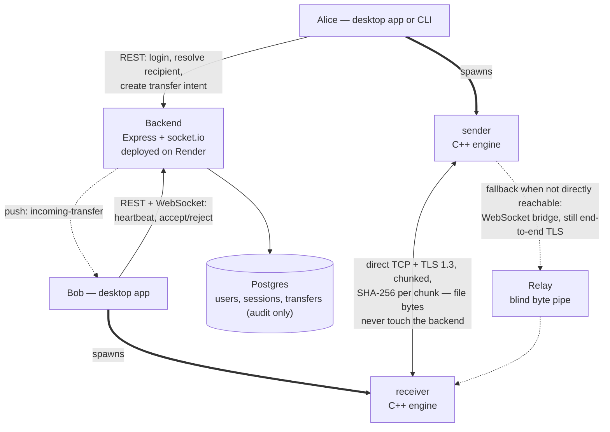

# PeerPayload Enterprise

Send a file directly to a colleague's machine. Log in, pick their name from
a list of who's online, and the transfer runs straight between the two of
you — the file's bytes never pass through a server. A small backend only
handles accounts, presence ("who's online right now"), and an audit trail
of what was sent, to whom, and whether it finished.


Two ways to use it, sharing one implementation underneath:

- **Desktop app** (Electron + React) — install it, sign in, pick a
  colleague, send. Runs in the system tray so it can receive files in the
  background.
- **CLI** (`peerpayload`) — `login`, `send`, `status`, `history`. Send-only:
  receiving still needs someone's desktop app running on the other end.


The C++ transfer engine underneath (`sender`/`receiver`) also works as a
fully standalone pair of CLI binaries with no account system at all: see
[the engine](ENGINE.md).

## Architecture



This is a **control plane / data plane split**:

- **Control plane** (through the backend): who you are, who's online, and
  "does Bob want this file" — a REST API for everything except the live
  push notification, which goes over an authenticated per-user socket.io
  channel (`user:<id>` room).
- **Data plane** (client-to-client): once Bob accepts, his client
  spawns `receiver`, Alice's client spawns `sender`, and the two connect
  to each other directly over TLS. The backend is never in this path and
  never sees file contents — only a final self-reported "it worked" or
  "it failed" for the audit log.
- **Relay fallback** (for machines on different networks): Alice's client
  first checks whether Bob's advertised address answers (3 s). If not, or
  if it turns out to be a different machine (the certificate pin doesn't
  match), the two clients carry the engine's bytes over WebSockets through
  `relay/` instead. The engines don't change: each talks to a local bridge
  (`client-core/relayBridge.js`). The relay only forwards the engines' TLS
  stream, so it sees ciphertext, and the sender's certificate pin means it
  can't impersonate Bob either. Access is by short-lived tickets the
  backend signs for the two parties of a live transfer; the relay checks
  the signature and needs no database. The sender's report records which
  path was used (`direct` or `relay`).
  The same relay also serves PeerPayload Connect, which has no backend:
  there each device signs its own ticket with its device key
  (format in `protocol/relayTickets.js`), naming the device it wants to meet. The
  relay checks the certificate matches the claimed device ID and the
  signature is valid, and only pairs two devices that name each other.
  Because anyone can make a key pair, the relay caps connections per IP
  address.

## Components

| Path | What it is |
|---|---|
| `sender/`, `receiver/`, `shared/` | The C++ engine — TLS, resumable, pipelined chunk transfer. No knowledge of accounts, backend, or either client. |
| `backend/` | Express + Prisma/Postgres + socket.io. Auth (bearer tokens, DB-backed sessions so admin revocation is immediate), presence (heartbeat + TTL), directory lookup, and transfer audit records. Deployed on Render. |
| `client-core/` | The one client-side implementation of "talk to the backend" and "spawn the engine and read its JSON event stream" — shared by both `desktop/` and `cli/` so there's exactly one copy of that logic. |
| `desktop/` | Electron + React. `electron-builder` produces a Windows installer (NSIS) and a Linux AppImage. |
| `cli/` | `peerpayload` — commander-based, `login`/`send`/`status`/`history`. |
| `packages/ui/` | Presentational React components (`Meter`, `StatTile`, `StatusBadge`, `ThemeToggle`) shared by the desktop apps. |
| `relay/` | Stateless WebSocket relay for transfers that can't connect directly. Pairs the two sides of a transfer by backend-signed ticket and forwards their bytes with flow control. Its own service, so relayed traffic never competes with the API. |
| `render.yaml` | Render Blueprint — deploys `backend/` with its Postgres, and the relay as a separate service sharing a generated `RELAY_SECRET`. |

## Using it

The backend is already deployed; the client apps have its URL baked in at
build time, so there's no server address to configure.

**Desktop app:** install the built package for your platform, sign in with
an account an admin created for you, and send. Receiving requires the app
to be running (it can be minimized to the tray — closing the window
doesn't quit it).

**CLI:**

```sh
peerpayload login
peerpayload send "C:\path\to\file-or-folder" --to someusername
peerpayload status    # active transfers
peerpayload history   # everything
```

Add `--json` to any command for machine-readable output.

## Accounts

There's no self-registration. The first admin account is created directly
against the database:

```sh
cd backend
node src/scripts/createAdmin.js <username> <password>
```

From there, an admin creates everyone else's accounts through the `users`
API.

Everyone changes their own password in the desktop app (Settings ›
Account › Change password) or with `peerpayload passwd`. It needs the
current password, and signs out the account's other devices; the one used
stays signed in.

## Running the backend locally

```sh
cd backend
cp .env.example .env   # point DATABASE_URL at a local Postgres
npm install
npx prisma migrate dev
npm run dev
```

Point a client at it instead of the deployed backend with
`PEERPAYLOAD_SERVER=http://localhost:4000` (both the desktop app's dev
build and the CLI read this env var; the desktop app's `electron-builder`
config bakes in the production URL for a packaged install instead).

## Known limitations

- **No self-registration or SSO.** Accounts are admin-created only
  (`createAdmin.js` bootstraps the first one).
- **Relay, not hole punching.** Machines that can't reach each other
  directly always go through the relay; there's no NAT traversal or
  router port-mapping (UPnP/NAT-PMP) yet. Relayed transfers are slower and
  cost relay bandwidth. Each sender report records `path`, so the share of
  relayed traffic is measurable before deciding whether port-mapping is
  worth building. (Connect tries a reversed connection before the
  relay, see [PeerPayload Connect](CONNECT.md).)
- **Relay on Render's free tier** spins down when idle, so the first
  relayed transfer after a quiet period waits for it to start, and its
  bandwidth allowance is limited. For real use, move the relay to a
  paid plan or a VPS and change `RELAY_URL`; nothing else changes.
- **An unreachable receiver on an old client** (no relay bridge) makes
  the sender wait for the relay pairing timeout (30 s) before reporting
  `not_reachable`.
- **The audit trail is client-self-reported, not tamper-proof.** Both
  sides report their own outcome after a transfer; the sender's report
  wins if they disagree. Fine for "did this generally work," not a
  cryptographic guarantee.
- **Certificate pinning trusts the backend.** The fingerprint the sender
  pins to comes from the backend over HTTPS, so a compromised backend
  could substitute its own. Standalone runs without `--pin-sha256` have no
  receiver authentication at all.
- **Login rate limiting is per process.** Failed logins are capped per
  IP+username and per IP in memory; running several backend instances
  would need a shared store.
- **Render's free tier cold-starts** after ~15 minutes idle, adding
  30–50s of latency to the first request after a quiet period. A
  heartbeat can report "online" before the signaling socket that actually
  delivers the incoming-transfer push has finished reconnecting.
